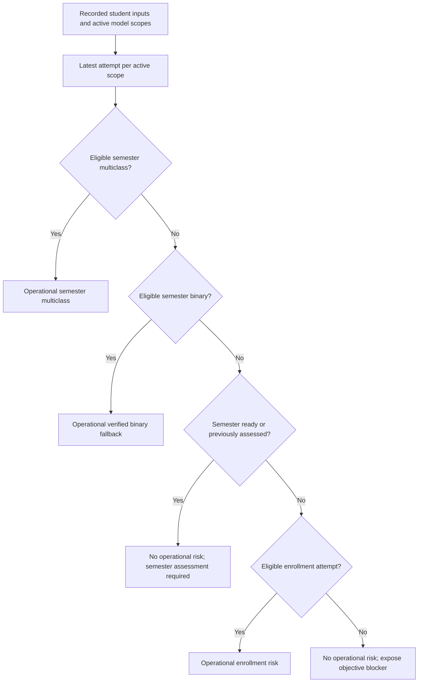
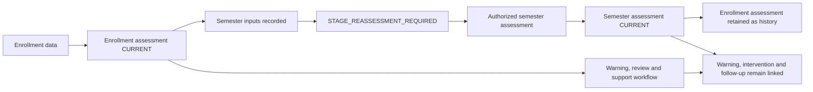
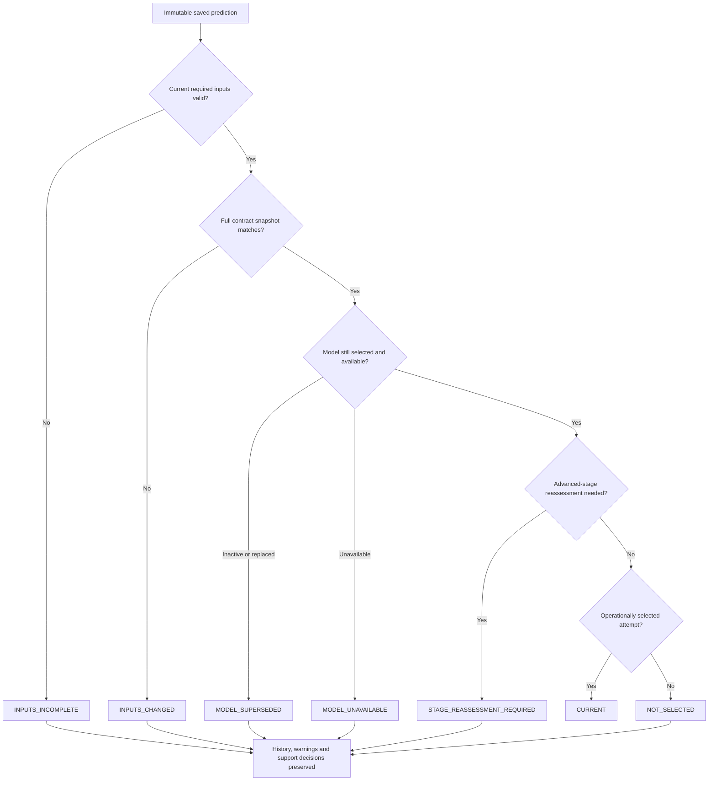

# Phase B2: prediction freshness and operational risk

## Baseline recorded before implementation

Base `5e6dcdff95205a79eb778f9e646780c9bdb5a2e2`. B1 dashboard risk and
readiness use legacy binary only; registry and dossier use the newest timestamp
across stages. None compare immutable prediction snapshots to recorded inputs.
Registry support joins the latest prediction's warning and can hide ongoing
casework after a LOW prediction. All three trained models must remain unchanged.

## Implemented backend contract

Use deterministic read-time comparison against each model's own canonical
21/27/30-input contract. Do not add fingerprints or mutate historical snapshots:
existing snapshots already contain the full auditable inputs and are sufficient.
No invalidation hooks are needed for CRUD/imports; all committed changes are
visible through the same database projection. Add an index-only migration after
B1 for indexed latest prediction lookups.

The newest attempt of each selected active model is authoritative within its
scope, ordered by `predicted_at DESC, id DESC`. Do not resurrect an older attempt
when a newer attempt has incompatible inputs. Compare at most three candidates
per student, with indexed correlated lookups rather than loading full histories.
Select valid first-semester multiclass, then valid first-semester binary, then
enrollment. Ready semester-one inputs (or any previous first-semester assessment)
require a first-semester assessment; enrollment then supplies historical context
only. Binary provides a first-semester fallback when available and input-ready.
An unavailable higher-stage model is reported explicitly.

SQL projects objective snapshot, input, stage and active-model facts. Request
read transactions use a consistent PostgreSQL snapshot so count/page/detail
queries cannot disagree during concurrent edits or activation. Artifact
availability is verified and cached separately from input comparison; no model
inference is used to decide freshness.

The frontend retains its typography, panels, tables, navigation and responsive
layout. Neutral compact freshness labels qualify historical risk; current risk
and academic support obligations remain separate.

## Operational selection and stage progression

`assessment_service.py` is the single policy implementation shared by dashboard,
registry, dossier and prediction history/detail responses. For each student it
uses indexed lookups for the latest historical prediction and the newest attempt
of each active model scope. Within a scope, order is `predicted_at DESC, id DESC`;
an older matching attempt is not resurrected over a newer incompatible attempt.

An eligible attempt has a verified available artifact, the matching stage/schema,
the selected active model identity, complete valid recorded inputs, and a matching
snapshot covering every required feature. Select:

1. Eligible FIRST_SEMESTER / MULTICLASS_OUTCOME.
2. Eligible FIRST_SEMESTER / BINARY_DROPOUT.
3. Eligible ENROLLMENT / MULTICLASS_OUTCOME, only before semester progression.

A later enrollment timestamp cannot override eligible semester risk. A binary
assessment at the same advanced stage can supply operational risk when multiclass
is inactive, unavailable, absent or stale. This fallback does not invent Enrolled
or Graduate probabilities. Model family preference alone does not force a new
assessment when a valid same-stage binary assessment exists.

Progression occurs when all 27 semester inputs are ready or the student has any
previous FIRST_SEMESTER assessment. Once progressed, missing semester inputs do
not regress the operational assessment to enrollment. If neither semester model
has an eligible attempt, operational prediction is null, historical enrollment
risk is context only, and reassessment is required. Inactive/unavailable models
are explicitly reported. An initial student with no prediction is NO_PREDICTION,
not counted as requiring *re*assessment; recommended stage may still be semester
one when those inputs are already ready.

## Freshness states

| State | Meaning |
| --- | --- |
| CURRENT | Input-consistent, available active model and selected operational attempt. |
| NOT_SELECTED | Inputs match an active available model, but this historical attempt is not authoritative/selected; a newer attempt or preferred scope takes precedence. |
| INPUTS_CHANGED | Relevant snapshot values differ, or the historical snapshot lacks/has invalid required inputs. |
| INPUTS_INCOMPLETE | Current recorded inputs required by this prediction's contract are missing or invalid. |
| MODEL_SUPERSEDED | Model is inactive/replaced in its scope, or the model/schema cannot supply the selected assessment. |
| MODEL_UNAVAILABLE | Selected model artifact/registry/runtime is unavailable or inconsistent. |
| STAGE_REASSESSMENT_REQUIRED | Enrollment inputs may still match, but advanced-stage assessment is required and no eligible semester assessment exists. |
| NO_PREDICTION | Student has no prediction history, or a candidate scope has no attempt. |

Per-record diagnosis checks missing/invalid current inputs, snapshot mismatch,
model selection, artifact availability, stage progression and operational
selection in that order. Student-level status describes the operational blocker:
CURRENT wins when an eligible assessment exists; absent history stays
NO_PREDICTION; semester progression cannot be bypassed by enrollment. If the
preferred family lacks an attempt, a relevant existing active attempt's actual
blocker is used rather than mislabeling changed binary inputs as supersession.
`is_operational_current` and `requires_reassessment` make the record/student
distinction explicit. An elapsed duration alone never invalidates an assessment.

## Feature comparison and numerical normalization

No hash/fingerprint column or historical backfill is necessary. Every comparison
uses the original immutable `feature_snapshot`, with the prediction's own
canonical schema: 30 legacy binary, 21 enrollment, 27 semester multiclass inputs.
Required numeric JSON keys must exist and have numeric types; guarded casts
reject malformed snapshots without turning them into current risk. All required
fields participate. Extra unrelated snapshot keys do not invalidate a result.

For fixed-scale NUMERIC storage (grades are NUMERIC(8,2)), comparison rounds the
snapshot value to that storage scale, then compares the double-precision numeric
representation of both values. Python detail diagnostics use Decimal(str(value))
with ROUND_HALF_UP at the same scale. Integer and unrestricted numeric fields
compare their finite double representations, matching inference's Decimal-to-float
conversion. Signed zero and `125.5`/`125.500000` match; a grade submitted as
`125.504` persists as `125.50` and remains unchanged, whereas `125.505` persists
as `125.51` and invalidates the affected snapshot. No grades or evaluation counts
are imputed during freshness evaluation. This follows PostgreSQL's documented
[NUMERIC storage rounding](https://www.postgresql.org/docs/16/datatype-numeric.html).

Name, gender display text, advisor assignment, warning review, intervention notes
and follow-up activity are outside these feature contracts. Scholarship, tuition,
debtor and admission features affect both multiclass stages. Semester measurements
affect semester models; macroeconomic fields affect only the frozen binary model.
Model inference is never rerun to determine input freshness.

## Mutation coverage and historical support

All supported mutations remain unchanged: Student CRUD, admission and semester
upserts, regular CSV import and staged CSV commit. Comparison reads persisted
facts directly, so there is no fragile invalidation hook or manually editable
CURRENT flag. Both import paths currently insert students and reject conflicting
student numbers; they do not bulk-overwrite existing academic data. Imported
students are immediately assessable according to their actual stage inputs.
Tests assess imported rows and then verify academic changes invalidate them.

Freshness logic performs no updates to predictions, model versions, warnings,
reviews, interventions or follow-ups. It neither dismisses warnings nor closes
support plans. Registry support selection prioritizes an ongoing intervention's
warning, then a nondismissed warning, then latest warning context, independently
of operational risk. Its representative intervention retains the existing
action-required/in-progress/planned ordering. Dossier history preserves all
linked casework and exposes `open_warnings` independently of current risk.
Legacy `active_warning` remains the last chronological assessment's warning for
compatibility; the UI uses `open_warnings` for open support workflows.

## Dashboard definitions

Default `prediction_scope=OPERATIONAL_CURRENT`:

- `students.current_assessed`: students with a selected operational prediction.
- `risk_distribution.low/medium/high`: each such student contributes once to
  their selected prediction's calibrated risk tier.
- `students.reassessment_required`: students with history but no current result.
- `students.without_predictions`: students with no prediction history.
- `students.with_latest_prediction`: historical coverage, not current coverage.
- `students.prediction_ready`: inputs complete for at least one stage contract.
- `data_freshness.last_prediction_at`: latest prediction activity across stages.
- Warning, intervention and follow-up totals retain all-stage support semantics.

Invariants: LOW + MEDIUM + HIGH = current_assessed; current_assessed +
reassessment_required + without_predictions = total. Missing or stale risk is
never LOW. The distribution combines calibrated *categories*, not average
probabilities or a single shared threshold. The UI explicitly describes that
scope. Legacy model thresholds are labeled as a legacy reference.

`prediction_scope=LEGACY_BINARY_FIRST_SEMESTER` preserves B1 historical binary
risk/readiness/coverage/activity semantics for academic comparison. The response
also exposes `legacy_risk_distribution`; this historical statistic can include
outdated snapshots and must not be used as operational current risk. Prediction
Analytics explicitly requests the legacy scope for its legacy KPI section.

Attention order is current HIGH, current MEDIUM, reassessment required, then
existing overdue scheduled support; within each group, student number then UUID.
It is a deterministic categorical order, not a fabricated priority score.
Limit remains 10. Stale historical HIGH/MEDIUM does not supply a current probability
or risk badge. Linked warning review/intervention actions retain existing RBAC.

## Registry, dossier and API contracts

All endpoints remain authenticated with existing read roles. Only Academic Admin
executes predictions; System Admin model administration is unchanged.

| Contract | B2 behavior |
| --- | --- |
| GET `/dashboard/overview` | Operational scope by default; optional explicit legacy scope; current/reassessment/no-history counts and selected-risk attention list. |
| GET `/student-registry` | SQL-filtered/paginated operational risk and readiness with historical/support context. |
| GET `/students/{id}/profile` | Current result, last chronological history, stage readiness, reasons, full prediction/support history and open warning workflows. |
| GET prediction list/history/detail | Original history/pagination retained; adds freshness, operational-selection and reassessment metadata. |
| POST single/batch predictions | B1 stage selection, authorization, actual inference, append-only persistence and warning generation retained. No deduplication added. |
| Readiness endpoints | Existing omitted-stage 30-input contract and explicit 21/27-input B1 contracts retained. |

Student responses add `operational_prediction`, `latest_historical_prediction`,
`assessment_status`, `reassessment_required`, `recommended_stage`,
`recommended_target_type`, `recommended_model_version`,
`recommended_model_available`, `enrollment_ready`, `first_semester_ready`,
`legacy_ready`, and `assessment_as_of`. Existing `latest_prediction` remains a
historical chronological alias for practical backward compatibility.

Prediction responses add `prediction_freshness`, `is_operational_current` and
`requires_reassessment`. Detail/dossier records expose changed/missing feature
names, original snapshot and retained explanation method. History export includes
freshness and selection fields so an old probability is not mislabeled current.

Registry filters:

- `risk_level` retains its name but now uses operational selected risk;
  `current_risk=LOW|MEDIUM|HIGH|NONE` explicitly supports empty current risk.
- `assessment_state=CURRENT|REASSESSMENT_REQUIRED|NOT_ASSESSED` maps to selection,
  the reassessment boolean, or absent history respectively.
- `prediction_stage=ENROLLMENT|FIRST_SEMESTER` filters selected operational stage.
- With `stage_readiness=READY|NOT_READY`, `prediction_stage` instead selects the
  input contract; it includes unassessed students. Missing stage is a structured
  STAGE_REQUIRED error. The UI disables this filter until a stage is selected.
- Generic `prediction_readiness` now means any stage's inputs are ready;
  `legacy_ready` preserves explicit 30-feature readiness.
- `risk_probability` sorting uses selected operational probability, NULLS LAST,
  and ascending student UUID for deterministic ties. Search, course, support
  filters, pagination and other sorts remain server-side.

The dossier retains existing tabs. Its current section never substitutes an
outdated probability, historical cards include neutral freshness qualification,
and missing/changed inputs and model availability accompany reassessment actions.
Open warning workflows, interventions and follow-ups are shown separately.

## Migration, query strategy and concurrency

Revision `20261013_0011` follows B1 `20261011_0010` without modifying it. It only
adds three prediction indexes: `(student_id, model_version_id, predicted_at DESC,
id DESC)`, `(student_id, predicted_at DESC, id DESC)`, and `(student_id,
prediction_stage)`. No columns, backfill, foreign keys or historical rows change.
Populated upgrade/downgrade tests compare complete original model/prediction and
support rows before and after migration. Ordinary index creation can briefly
block writes during deployment; plan that step according to database size.

Layered SQL CTEs calculate conditions once and use indexed correlated LIMIT 1
lookups. Dashboard aggregates in SQL. Registry filters/count/sort/page are SQL;
Python hydrates only the selected page and its representative predictions/support.
No query per student is added. Freshness compares at most three active-scope
attempts per student; only explicitly requested history/detail rows are compared
for history metadata. Dossier still returns one student's full history, as in B1.
The PostgreSQL scalability check uses 1,002 students, a 25-row page and a bounded
statement count of at most 16, independent of cohort size.

Read-model and prediction-history/detail endpoints use a separate PostgreSQL
REPEATABLE READ, READ ONLY session after unchanged authentication. Counts, page
selection, selected risk and payload share one MVCC snapshot, including active
model flags. `assessment_as_of` records transaction time; a concurrent commit may
require a later refresh but cannot mix old/current facts within that response.
Concurrency tests commit an academic edit and model activation change in another
connection while a reader retains its snapshot, then verify the next read sees
the change. This uses PostgreSQL's documented
[repeatable-read snapshots](https://www.postgresql.org/docs/16/transaction-iso.html).
Prediction execution and all casework transactions retain their existing rules.

DB activation state is read each time. Artifact verification is cached separately
by trusted paths, file stat identity and persisted registry metadata; changes or
missing artifacts are reverified/rejected. Verification's real probe inference
occurs on cache initialization/change, never as a substitute for feature comparison.

## Validation and limitations

Registered artifacts, schemas, thresholds, class encoding, explanations and
training/selection code have no diff from B1; no registered model was retrained.
Freshness means compatibility and operational eligibility, not guaranteed
academic accuracy, causal explanation or institutional validation.

Remaining limits: request-time snapshots require refresh after later commits;
no notifications, batch deduplication, freshness cache or new casework lifecycle
are introduced. B1's frozen model registry still supports its existing registered
versions. Very large histories may warrant later dossier pagination and query
plan tuning; this phase retains its full-history contract.

## Actual verification results (14 October 2026)

- Final full backend suite: **289 passed, zero skipped**, 238 warnings, 351.44
  seconds. All PostgreSQL integration environment variables and real-model
  integration were enabled against the dedicated local test server. This includes
  **37 PostgreSQL cases**, of which 11 are new B2 cases. The earlier resumed run
  encountered five disk-full failures; after the disposable cluster was
  checkpointed and disk space recovered, two full reruns passed. No unresolved
  test failure remains.
- PostgreSQL tests demonstrate populated index-only migration and rollback,
  unchanged historical probabilities/timestamps/support decisions, NUMERIC
  normalization, stage precedence, concurrent input edits and model activation,
  and a 25-row registry page over 1,002 students using at most 16 SQL statements.
- Frontend `npm run typecheck` and `npm run build`: passed on the final source;
  all 14 application routes built. Targeted Ruff check for the new assessment
  service and `git diff --check`: passed.
- `alembic heads`: only `20261013_0011`. All original artifact verification
  commands passed, with no diff under `backend/app/ml` from the B1 baseline.

Browser verification used the final production frontend and migrated backend
against **disposable PostgreSQL**, with real model inference and no mocked
student counts or probabilities. Through the UI, a student was created, all 21
enrollment values were recorded, and enrollment inference produced MEDIUM
25.0% (actual probability `0.2497711730787302`). Dashboard attention, registry
and dossier agreed. Correcting admission grade from 125.5 to 124.25 removed
current risk and displayed academic-input-change/reassessment reasons while
retaining the original assessment and warning. Rerunning enrollment restored
current MEDIUM risk (26.1%). Recording six semester inputs required first-semester
reassessment, with no current probability. The recommended UI action selected
first semester; inference then produced CURRENT LOW 18.2% (actual probability
`0.1819989821172857`). Registry and dossier agreed and dashboard counts excluded
outdated results. Both enrollment assessments and their two warnings remained
visible after the LOW result, with distinct historical freshness labels.

Additional genuine model examples rendered MEDIUM 22.6% and HIGH 47.6%. Light,
Dark and System modes and a 390px mobile viewport were checked visually. A
delayed request showed the dossier loading state; an intentionally aborted
request showed an unavailable/error state with Retry, and normal requests
restored the real assessment. The empty-current and stale states were exercised
before inference and after edits/progression. Academic Admin executed both
stages; Advisor and System Admin sessions had no execution button. Container API
requests independently verified both unauthorized roles receive HTTP 403.
Browser logs contained existing CSS preload warnings; normal workflow pages
had zero console errors. The deliberate failed-request check generated the
expected network error.

Docker runtime images for backend and frontend built successfully and the
isolated `b2-verification` stack started with PostgreSQL 16 in tmpfs. The running
container backend completed the same enrollment/edit/rerun/semester flow,
retaining three predictions and two warnings, agreeing across read-model APIs,
and rejecting both unauthorized execution roles. Browser login to the container
frontend also displayed the real first-semester LOW 18.2% result and retained
warning workflows. **Final-image revalidation is
limited:** after the host disk incident, Docker management requests timed out,
including a bounded direct named-pipe request. The last rebuild and Compose
cleanup could not complete. Those container images precede the final
`NOT_SELECTED` history qualification, fallback-reason fix and small UI label
corrections; the final native build/full tests/browser run cover those changes.
No shared Docker daemon restart, prune or deletion of other projects was
performed. Rebuild and remove the disposable `b2-verification` stack after
Docker management recovers.

Artifact SHA-256 values remain exactly the B1 values:

| Artifact | SHA-256 |
| --- | --- |
| Legacy binary | `0cdc1e57f145626bba9f46c729685d4ae0968fc39b96564c09c548f7577f1bd8` |
| Enrollment multiclass | `bc3690bb930b3320e029673282e3e6c5bedccbfd332cdd28953677dbfc1c8602` |
| First-semester multiclass | `2d6f7f80d6d6dcc2c844d9c3b714b1f5d7d92fa42d0a2db21fb3a3b139b5da81` |

## Delivery scope

Branch: `feat/phase-b2-prediction-freshness`, based on the expected B1 commit
`5e6dcdff95205a79eb778f9e646780c9bdb5a2e2`. The complete changed-file inventory is
[`phase-b2-changed-files.txt`](phase-b2-changed-files.txt). No PR, merge, history
rewrite or Phase C1 work is included. Local `main` remains
`c2487d5948d07f4a48bff07798250cda47bf25bb`; cached `origin/main` remains
`385f62f27901fdf5f294a8d19fc995d49de38667`. Neither ref was changed by this task.
